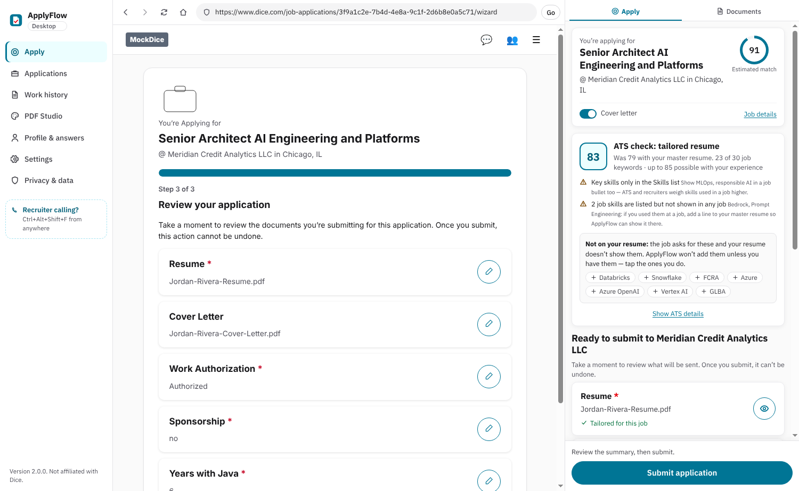

# ApplyFlow Desktop 2.1.0

See [RELEASE-2.2.0.md](RELEASE-2.2.0.md) for applying from Jobright.ai (Greenhouse, Lever, Ashby), [RELEASE-2.1.3.md](RELEASE-2.1.3.md) for getting back to your search after applying, [RELEASE-2.1.2.md](RELEASE-2.1.2.md) for the Education settings, [RELEASE-2.1.1.md](RELEASE-2.1.1.md) for the resume-replacement fix and [RELEASE-2.1.0.md](RELEASE-2.1.0.md) for the current setup, generation flow, installation steps and limitations. The older documentation below describes the 2.0 architecture; its master-resume/work-history workflow has been replaced.

# ApplyFlow Desktop

**Version 2.0.0** — a Windows desktop app that writes an ATS-optimized, truthful resume and cover letter for each Dice job, applies in about two clicks in its built-in Dice browser, and keeps **every application, every resume version and every recruiter contact in a local SQLite database** — so when a recruiter calls, you find the company and the exact resume you sent in seconds.

> ApplyFlow is an independent tool. It is not affiliated with, endorsed by, or operated by Dice.



---

## What's new in 2.0 (from the Chrome extension)

| | 1.x extension | 2.0 desktop |
|---|---|---|
| Where it runs | Chrome side panel | Its own window: built-in Dice browser + ApplyFlow panel |
| Your data | Browser storage (IndexedDB) | One SQLite file you can back up |
| Finding an application | Scroll the history table | **Search by phone number**, recruiter, company, email, title or any word in the posting — **Ctrl+Alt+Shift+F** from anywhere |
| Resume sent | A file somewhere in Downloads | Every version kept with its JSON; the one you submitted is marked **Sent**; preview it instantly |
| Claude requests per job | 2–3 (resume, cover letter, refine) — each re-sending the job and your facts | **1**, with your facts in a cached system prompt |
| PDF | Built from the reply | Built by ApplyFlow's **non-AI renderer** from resume JSON — re-render any time in **PDF Studio**, no tokens |

### The resume logic

```
 Dice job ──► local analysis + ATS plan (keywords your resume backs, title, years, bullets per job)
                     │
                     ▼
   ONE Claude request ── system (cached): rules + your confirmed facts
                         user: compact plan + job posting (legal boilerplate removed)
                     │
                     ▼  JSON: headline, summary, skills, bullets per job, cover-letter paragraphs
   local assembly ── employers, titles, dates, education, contact details from YOUR work history
   truthfulness check ── anything not backed by your facts is reverted
                     │
                     ▼
   resume JSON (applyflow.resume/1) ──► ApplyFlow renderer (no AI) ──► PDF / DOCX
                     └── stored in SQLite + saved as resume.json
```

Measured on the example resume and job (input characters per job, `tests/unit/applicationPrompt.test.ts`):

| | 1.x | 2.0 first job | 2.0 next jobs (cache) |
|---|---|---|---|
| Input sent | ~30,800 | ~10,600 | ~4,800 effective* |

\*Cached input is billed at about a tenth of the normal rate while the cache is warm (5 minutes by default, refreshed by each job; a 1-hour option is in Settings). Output is smaller too: Claude no longer writes a change log, and the refine pass (a second request) is now opt-in. Settings → **Claude token usage** shows your real numbers; each application shows its own.

Details: [docs/RESUME_JSON.md](docs/RESUME_JSON.md).

---

## Install (Windows 10/11, x64)

1. Run **`ApplyFlow-Setup-2.0.0.exe`**. It isn't code-signed, so Windows SmartScreen may say "Windows protected your PC" — click **More info → Run anyway**. (Or use `ApplyFlow-2.0.0-portable.exe`, which runs without installing.)
2. Open **ApplyFlow** from the Start menu or desktop.

### First run

1. **Work history** — fill in the form (each real job: company, title, city, months, what you did, tools) or **Upload a file** (PDF/DOCX). ApplyFlow writes every tailored resume from this and nothing else.
2. **Profile & answers** — check contact details; optionally save answers you approve for reuse.
3. **Settings → Claude writing** — paste your Anthropic API key (set a spend limit on it), **Save key**, **Test API key**. Without a key the built-in writer is used.
4. **Apply** — sign in to Dice in the built-in browser (use email + password; Google sign-in is blocked inside embedded browsers). Your sign-in is remembered.

Coming from the 1.x extension? In the extension: History → **Export JSON**. Here: Applications → **Table view** → **Import**. Then upload your master resume under Work history.

## Using it

**Apply.** Open any Dice job in the built-in browser (search box at the top, or paste a link). The estimated match and ATS check appear without a click. Press **Tailor & Apply** (in the panel or on the Dice page): ApplyFlow writes the documents, opens Dice's application, replaces your profile resume with the tailored one, attaches the cover letter, fills what it safely can and presses Next — and stops for questions it must not guess (one tap each) and at Dice's review step. Press **Submit application**. Done: recorded, files saved, follow-up reminder set.

**Running in the background.** Closing the window doesn't exit ApplyFlow — it keeps running in the system tray (the menu bar on macOS), so reminders and the shortcut below keep working. Click the tray icon (or launch ApplyFlow again) to bring the window back; right-click it → **Quit ApplyFlow**, or use File → Exit, to exit for real. On Windows 11 a new tray icon may sit under the **^** next to the clock until you drag it out.

**A recruiter calls.** Press **Ctrl+Alt+Shift+F** (works even when ApplyFlow is in the background or its window is closed), type any part of their number, their name, the company or a word from the job. Phone numbers and emails in job postings are saved as contacts automatically; add the recruiter yourself with **Add contact**. The application shows the resume and cover letter that were sent (Preview / Open / PDF Studio), the job posting, your notes and a quick call log.

**PDF Studio.** Open any saved resume (or a JSON file, or JSON Resume), edit the JSON, pick a template (Classic, Modern accent, Compact), font and size, and save PDF or DOCX — all local.

**Files.** `Documents\ApplyFlow\<Company>\<date>_<Job-Title>\` — `resume_tailored.pdf/.docx`, `cover_letter.pdf/.txt`, `resume.json`, `job_description.txt`, `application_metadata.json`, `job_url.txt`. Change the location in Settings → Saved documents.

**Your data.** `%APPDATA%\ApplyFlow\applyflow.sqlite` (Privacy & data → Open data folder). Back up by copying that folder after quitting ApplyFlow (tray icon → Quit ApplyFlow). See [docs/PRIVACY.md](docs/PRIVACY.md).

---

## Build from source

Requirements: **Node.js 22.12+** (tested with 22.23) on Windows. No native modules — the database is Node's built-in `node:sqlite`.

```bash
npm ci
npm run typecheck
npm test
npm run dev          # build and start the app
npm run dist:win     # release/ApplyFlow-Setup-2.0.0.exe and ApplyFlow-2.0.0-portable.exe
```

On Linux/macOS, `npm run dist:win` also works with Wine installed. `npm run icons` regenerates the icons from the mark (needs Playwright).

### Project structure

```
electron/
  main.ts          window, app:// protocol, IPC, built-in Dice browser (WebContentsView), reminders, Ctrl+Alt+Shift+F
  db.ts            SQLite store: resumes, profile, sessions, applications, documents, contacts, usage, FTS5 search
  preload.ts       window.applyflow bridge (invoke / on)
  dicePreload.ts   the page helper for dice.com (runs the content controller)
src/
  desktop/         shell (DesktopApp), BrowserPane, ApplicationsView ("who is calling?"), PdfStudio, PdfFrame
  platform/        bridge.ts — every IPC method and event, typed
  resume-renderer/ applyflow.resume/1 schema, JSON Resume import, renderer API (PDF/DOCX/TXT)
  prompts/         application.ts — the single compact request (schema, cached system prompt, compact plan/job)
  sidepanel/       the ApplyFlow panel (PanelApp, HomeView, useWorkflow)
  content/         content controller (page logic), launcher, file-chooser helper
  services/        ats/ claude/ export/ tailoring/ matching/ resume/ workflow/ platforms/dice/ …
  storage/         repositories (SQLite through the bridge; IndexedDB fallback for tests)
scripts/
  build.mjs           renderer + Electron bundles + CLI
  e2e-desktop.mjs     end-to-end run of the real app against mock Dice pages
  applyflow-render.ts command-line renderer
  make-icons.mjs      app icons from the ApplyFlow mark
build/                icon.ico, icon.png, icons/
```

## Tests

- **232 tests** across 24 files (`npm test`), including:
  - SQLite store: resumes with their original file, default resume, documents per version and the **Sent** mark, token usage, and search by phone number in any format, recruiter, email, company, posting text and notes;
  - the single Claude request: no contact details sent, deterministic facts (cache hits), cache breakpoints and TTL, compact plan ids, boilerplate removal, the letter only when wanted, and a measured comparison with 1.x;
  - the renderer: resume JSON round trip, JSON Resume import, lenient reading, every template passing the ATS parse test;
  - everything from 1.x: Dice extraction, the wizard, uploads, truthfulness validator, ATS engine, exports, panel integration.
- **End to end** (`xvfb-run -a node scripts/e2e-desktop.mjs` after `npm run build`): starts the real app with a throw-away data folder and mock Dice pages (nothing reaches dice.com), imports a resume, opens a job in the built-in browser, Tailor & Apply, answers the questions, submits, then finds the application by the recruiter's phone number, previews the resume that was sent and renders it in PDF Studio. Output: `docs/screenshots/`.

## Docs

- [Resume JSON and the renderer](docs/RESUME_JSON.md)
- [Privacy](docs/PRIVACY.md)
- [Known limitations](docs/KNOWN_LIMITATIONS.md)
- [Changelog](CHANGELOG.md)
